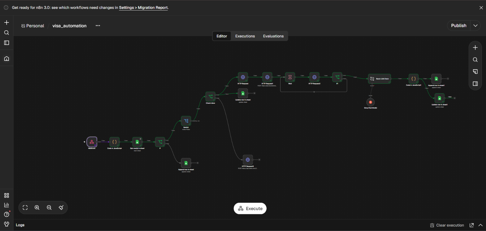

# Passport Automation with n8n

This is a small automation I built to extract passport details automatically instead of typing them in manually.

Basic idea: you send a photo of your passport on WhatsApp, and the workflow pulls out details like your name, passport number and date of birth, then saves everything to a Google Sheet. It's built entirely using n8n, with LlamaParse for reading the document and Groq for the actual extraction part.



## How it works

- User sends their passport photo on WhatsApp (using Twilio).
- The workflow does a quick check first — whether this is a duplicate entry, and whether the document is even present.
- The image goes to LlamaParse, which converts it into raw text.
- That text is passed to an LLM (running on Groq) which picks out the actual fields I need — full name, passport number, DOB, etc.
- Everything gets saved into a Google Sheet.
- Finally the user gets a WhatsApp message back confirming it went through.

## Tech used

- n8n (self-hosted using Docker) — for the actual workflow
- LlamaParse — to read/parse the passport image
- Groq — LLM for extracting structured fields
- Google Sheets — just using it as a simple database
- Twilio — for sending/receiving WhatsApp messages
- ngrok — for exposing my local n8n instance during testing

## Setup

1. Copy the env file and fill in your own values:
   ```bash
   cp .env.example .env
   ```
2. Set `WEBHOOK_URL` in `.env` to your ngrok URL (or wherever you're hosting it).
3. Spin up n8n:
   ```bash
   docker compose up -d
   ```
4. Go to `http://localhost:5678`, then Workflows → Import from File → pick `visa_automation.json`.
5. You'll need to add your own credentials inside n8n for:
   - Twilio (Account SID + Auth Token)
   - Google Sheets (OAuth)
   - LlamaParse API key
   - Groq API key
6. Activate the workflow and point your Twilio WhatsApp sandbox to the `WEBHOOK_URL`.

## Limitations (for now)

- I built this on a Twilio trial account, so it can only send back a pre-approved template message, not a custom one. Once I move to a paid plan, I can actually make it reply based on whether the extraction worked, passport looks valid, etc.
- Right now it only handles passports. The Switch/If logic is already there though, so adding other documents later shouldn't be too hard.

## Folder structure

```
visa-automation-n8n/
├── docker-compose.yaml
├── visa_automation.json     # exported n8n workflow
├── .env.example
├── README.md
└── screenshots/
    └── workflow.png
```

---

Built this mainly to get hands-on with n8n, LLM-based document extraction, and tying together a few different APIs (Twilio, LlamaParse, Groq) into one working pipeline.
